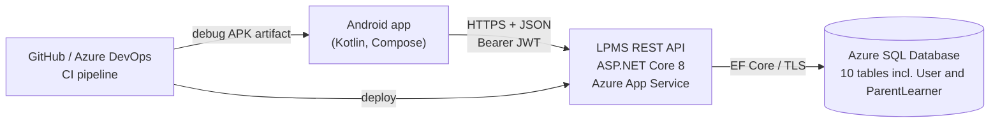

# LPMS - Literacy Programme Management System

[](https://github.com/Jxcob-Wxlly/LPMS-V2/actions/workflows/ci.yml)

**Client:** READ Educational Trust  **Team:** Team Point Blank  **Module:** XISD6329 (Task 2)

LPMS replaces the paper registers and spreadsheets READ Educational Trust uses to run its school literacy programmes.
This repository holds the Task 2 build: the **mobile app (Android) for teachers and parents**, the **REST API** that the app talks to, and the
**relational database**, plus the DevOps pipelines, automated tests and documentation.

| Part | Technology | Folder |
|---|---|---|
| Mobile app | Kotlin, Jetpack Compose, Material 3, Retrofit | [`android/`](android) |
| REST API | ASP.NET Core 8, Entity Framework Core, JWT, Swagger | [`api/`](api) |
| Database | SQL Server / Azure SQL (T-SQL scripts) | [`database/`](database) |
| Pipelines | GitHub Actions and Azure DevOps | [`.github/workflows/`](.github/workflows), [`azure-pipelines.yml`](azure-pipelines.yml) |
| Documentation | Markdown | [`docs/`](docs) |

## What the app does

A teacher signs in and can:

- **create their own account** from the sign-in screen (name, email, school, password) and be signed straight in;
- see a **dashboard** (sessions this week and today, learner count, attendance rate, sessions that still need attendance);
- browse **upcoming and past sessions**, **schedule a new session** for themselves (+ New) and **take attendance** (Present / Absent per learner, "All present" shortcut);
- **search learners** and open a learner's **progress** (average score, progress label, attendance history);
- **add, edit and delete assessments** (score 0-100, date, notes);
- use **Settings**: theme (light / dark / phone setting), larger text, remember username, server address with a connection test,
  change password, sign out;
- open the built-in **Help** (FAQ) from the sign-in screen or Settings.

A **parent / guardian** signs in with their own account and can:

- see **only their own children** with average score and attendance;
- see at a glance whether each child's attendance **meets their own expectation** (set in Settings, default 80%);
- open a **child report** (assessments, recent attendance) and **download it as a PDF** to save, print or share.

Teachers can also create the same PDF from a learner's progress screen. The API enforces the separation: a parent gets
403 for any child who is not linked to them, and for rosters, other learners and every teacher endpoint.

The whole app follows one design system (teal and amber, light and dark, Bricolage Grotesque headings with Figtree body text, bundled in the APK) so it matches the mockups the team designed.

Invalid input never crashes the app: every field is validated before anything is sent (see
[`Validators.kt`](android/app/src/main/java/com/teampointblank/lpms/domain/Validators.kt)), the API validates again, and every network
failure is turned into a friendly message.

## Architecture



**Authentication.** The API owns sign-in. `POST /api/auth/login` checks the password against the BCrypt hash in the `User` table
and returns a signed JWT (HS256, 8 hours). The app keeps the token in `EncryptedSharedPreferences` (Android Keystore) and sends it
as `Authorization: Bearer ...`. Passwords are never stored on the phone and never returned by the API. Login attempts are rate limited.

**Authorisation.** Roles are Administrator, Coordinator and Teacher. Teachers only reach their own sessions and their own school's
learners; only the teacher who recorded an assessment can change it; teachers schedule sessions for themselves only (the API takes teacher and school from the token), coordinators/administrators can schedule for any teacher. New teachers register through `POST /api/auth/register`.

## Repository layout

```
lpms/
├── android/                 Android Studio project (Gradle wrapper included)
│   └── app/src/main/java/com/teampointblank/lpms/
│       ├── data/            Retrofit API, models, token store, settings, repository
│       ├── domain/          Validators, formatters, attendance rules (pure Kotlin, unit tested)
│       └── ui/              Compose screens + ViewModels: login, home, sessions, learners, settings, help
├── api/
│   ├── Lpms.sln
│   ├── src/Lpms.Api/        Controllers, DTOs, EF Core model, services, Program.cs
│   └── tests/Lpms.Api.Tests integration + unit tests (xUnit, in-memory SQLite)
├── database/
│   ├── 01-create-schema.sql tables, keys, constraints, indexes
│   ├── 02-seed-data.sql     simulated data (10+ rows per table, BCrypt-hashed passwords)
│   ├── 03-demo-queries.sql  read-only queries used in the demo video
│   └── tools/generate-seed.py   generator + self-check for the seed data
├── docs/                    user guide, deployment guide, API reference, test plan, demo script, DevOps lifecycle
├── .github/workflows/ci.yml GitHub Actions: build, test, APK, deploy
└── azure-pipelines.yml      Azure DevOps equivalent
```

## Quick start

### 1. Database (Azure SQL or local SQL Server)

Run the three scripts in `database/` in order (Azure portal **Query editor**, SSMS or Azure Data Studio):
`01-create-schema.sql`, then `02-seed-data.sql`, then `03-demo-queries.sql` to check the data.
The seed script uses dates relative to today, so there are always sessions today, upcoming and in the past.
Full Azure steps are in [`docs/deployment-guide.md`](docs/deployment-guide.md).

### 2. API

Requires the [.NET 8 SDK](https://dotnet.microsoft.com/download).

```bash
cd api/src/Lpms.Api
# point the API at your database (or edit ConnectionStrings:LpmsDb in appsettings.json)
export ConnectionStrings__LpmsDb="Server=tcp:YOUR-SERVER.database.windows.net,1433;Database=LpmsDb;User ID=...;Password=...;Encrypt=True;"
dotnet run          # Development profile: http://localhost:5080/swagger
```

In Development a throw-away signing key is supplied by `appsettings.Development.json`. In any other environment set
`Jwt__Key` to a random string of at least 32 characters.

### 3. Android app

Open the `android/` folder in Android Studio (Ladybug or newer, JDK 17) and run it on a phone or emulator, or build from the command line:

```bash
cd android
./gradlew assembleDebug -PlpmsApiBaseUrl=https://YOUR-APP.azurewebsites.net/
# APK: app/build/outputs/apk/debug/app-debug.apk
```

The server address can also be changed inside the app (sign-in screen > **Server settings**, or Settings > **Change server address**),
which is handy for a PC on the same Wi-Fi: `http://192.168.x.x:5080/` (debug builds allow plain http; release builds require https).

### Demo accounts

All seeded accounts use the password **`Lpms@2026!`**.

| Username | Role | Notes |
|---|---|---|
| `teacher01` | Teacher | Nomsa Zulu, Soweto Primary - the main demo account |
| `teacher02` ... `teacher11` | Teacher | one per school |
| `teacher12` | Teacher | **inactive**: shows the "account inactive" message |
| `coord01`, `coord02` | Coordinator | can sign in to Swagger; the mobile app is for teachers and parents |
| `parent01` ... `parent10` | Parent | `parent01` and `parent02` each have two children (the best demo accounts) |
| `admin01` | Administrator | Swagger only |

## Tests

| Suite | Command | What it covers |
|---|---|---|
| API (xUnit, 100+ tests) | `dotnet test api/Lpms.sln` | every endpoint end-to-end over HTTP with an in-memory SQLite database: sign-in, roles, validation, attendance, progress, dashboard, parent access, business rules |
| Android (JUnit, 73 tests) | `cd android && ./gradlew testDebugUnitTest` | validators (incl. create-account and new-session rules), formatters, attendance rules, parent report rules, error mapping, JSON contract with the API |

Both suites run automatically on every push (see **CI/CD** below). The manual test table is in [`docs/test-plan.md`](docs/test-plan.md).

## CI/CD and the DevOps lifecycle

Pipelines: [`.github/workflows/ci.yml`](.github/workflows/ci.yml) (GitHub Actions) and [`azure-pipelines.yml`](azure-pipelines.yml) (Azure DevOps).
Each push builds and tests the API, runs the Android unit tests, builds a debug APK (downloadable from the run's **Artifacts**), and,
on `main`, deploys the API to Azure App Service and smoke-tests `/api/health`.

| Stage | How it is done in this project |
|---|---|
| Plan | Azure DevOps Boards: epics/user stories from the RAD, sprint backlog, task board |
| Code | Git feature branches, small commits, pull requests into `main` |
| Build | `dotnet build`, `./gradlew assembleDebug` |
| Test | xUnit API tests, JUnit app tests, manual test plan |
| Release | versioned build artifacts (published API, APK) |
| Deploy | `azure/webapps-deploy` / `AzureWebApp@1` to App Service; database scripts for Azure SQL |
| Operate | Azure App Service + Azure SQL; configuration through App Service settings (`Jwt__Key`, connection string) |
| Monitor | `GET /api/health` smoke test, App Service logs and metrics |

More detail: [`docs/devops-lifecycle.md`](docs/devops-lifecycle.md).

## Documentation

- [User guide](docs/user-guide.md) - how to use every screen of the app
- [Deployment guide](docs/deployment-guide.md) - Azure SQL, App Service, secrets, installing the APK
- [API reference](docs/api-reference.md) - endpoints, examples, error format
- [Test plan](docs/test-plan.md) - automated tests and the manual test table
- [Demo video script](docs/demo-video-script.md) - what to show and say
- [DevOps lifecycle](docs/devops-lifecycle.md)

## Changes from the System Design Document

| Change | Why |
|---|---|
| `User.TeacherID` (nullable FK to `Teacher`) | links a sign-in account to the teacher it belongs to, so the API can scope data to the teacher |
| At least 10 rows in every table (SDD sample data had 3) | the Task 2 brief requires it |
| Sign-in accepts email **or** username | teachers know both; `Email` and `Username` are both unique |
| Assessment names stored in `Progress.Notes` | the SDD `Progress` table has no separate name column |
| New `ParentLearner` table and `Parent` role | lets a parent sign in and see only their own children's attendance and progress (Task 2 extension, not in the SDD) |
| Seed dates relative to the day the script runs | there are always sessions "today" for the demo |

## Team

Team Point Blank - XISD6329.
