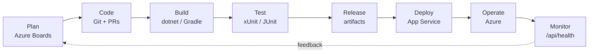

# DevOps lifecycle for LPMS

The Task 1 DevOps plan used eight stages. This is how each is carried out for Task 2, and where the evidence is.

| Stage | Practice | Tools | Evidence to show |
|---|---|---|---|
| **Plan** | User stories derived from the RAD (sign in, take attendance, record progress, settings, help, parent view and PDF report); tasks per story; sprint backlog; board columns To Do / Doing / Done | Azure DevOps Boards | Board screenshot with items moved to Done, linked to commits (`AB#<id>` in commit messages) |
| **Code** | Trunk-based flow: short-lived feature branches, small commits, pull request into `main`, CI must be green | Git, GitHub | Commit history, merged PRs |
| **Build** | API: `dotnet restore/build`. App: `./gradlew assembleDebug`. Warnings reviewed | GitHub Actions, Azure Pipelines | Green *Build* steps |
| **Test** | 100+ API tests and 73 app unit tests on every push; manual device tests in `docs/test-plan.md` | xUnit, JUnit | Test results artifact, test plan table |
| **Release** | Each green build on `main` produces a versioned artifact: published API and debug APK | Actions artifacts | Artifacts list on the workflow run |
| **Deploy** | `azure/webapps-deploy` (or `AzureWebApp@1`) pushes the API to App Service; database scripts applied to Azure SQL; secrets in App Service settings / GitHub secrets | Azure App Service, Azure SQL | Deploy job log, App Service *Deployment Center* |
| **Operate** | Configuration through environment settings (no secrets in Git); rate limiting on login; forwarded-headers support behind Azure's proxy | Azure portal | App Service *Environment variables* page |
| **Monitor** | `GET /api/health` smoke test after every deploy; App Service log stream and metrics; failed requests return structured JSON | Azure Monitor, log stream | Health JSON, log stream |

## Branching and commit conventions

- `main` is always deployable. Work happens on `feature/<short-name>` branches (`feature/attendance-screen`, `feature/api-auth`).
- Commit messages: imperative, one change each, e.g. `Add attendance endpoint and tests`. Reference the board item: `AB#12`.
- Suggested commit story for this repo (mirror your real history): database scripts, API skeleton + auth, sessions endpoints, progress endpoints, API tests,
  Android project, sign-in screen, sessions + attendance, learners + progress, settings + help, Android tests, CI pipeline, documentation.

## Azure DevOps board setup (10 minutes)

1. dev.azure.com > project **LPMS** > **Boards**. Create **Epics**: *Authentication*, *Sessions and attendance*, *Learner progress*, *Settings and help*, *Hosting and DevOps*.
2. Under each, add **User stories** ("As a teacher I want to ... so that ...") and **Tasks** (database, API, app, tests, docs).
3. Create **Sprint 1** and **Sprint 2**, drag stories in, and move tasks across the board as you finish them. Take screenshots at start, mid and end.
4. **Repos / Pipelines:** connect the GitHub repository (Pipelines > New pipeline > GitHub) and use `azure-pipelines.yml`. Add the *Azure Boards* app to GitHub so `AB#id` links appear on commits.
